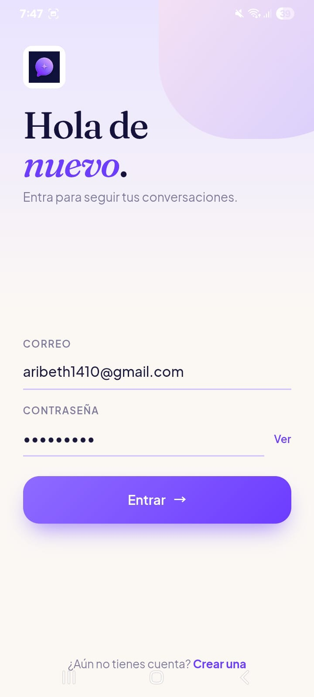
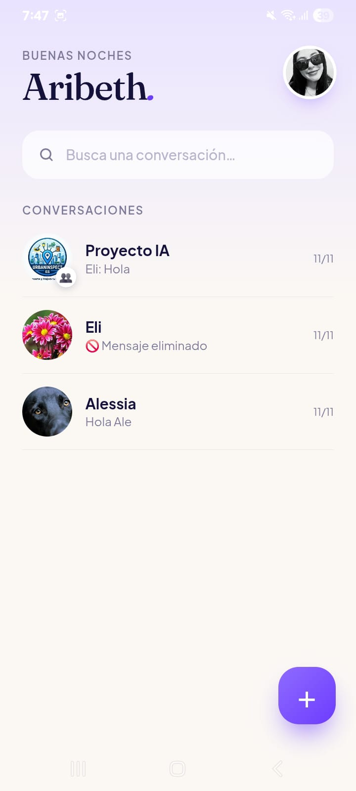
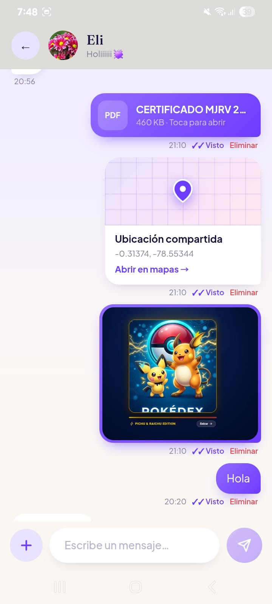
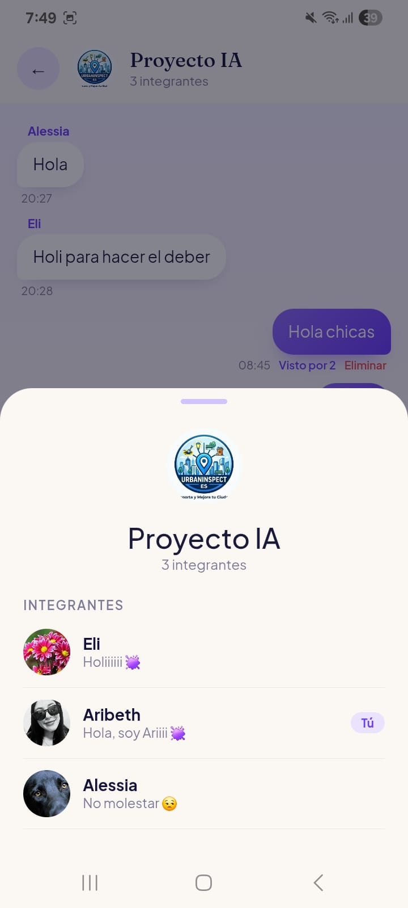
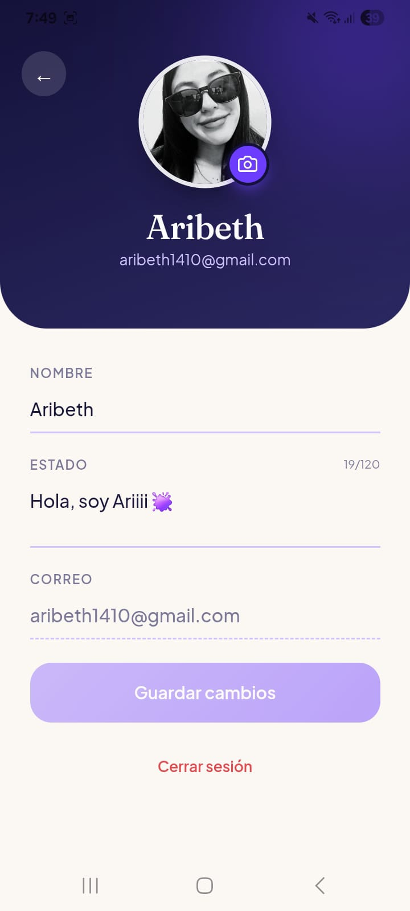
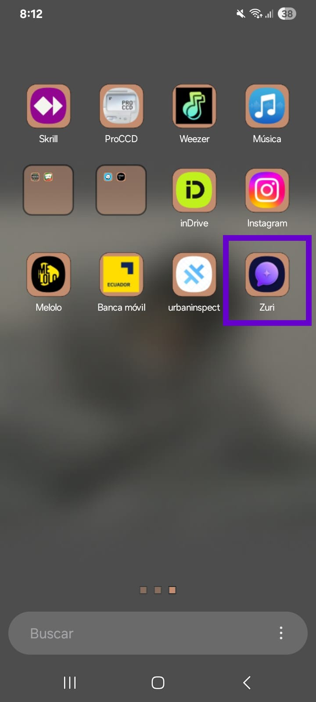
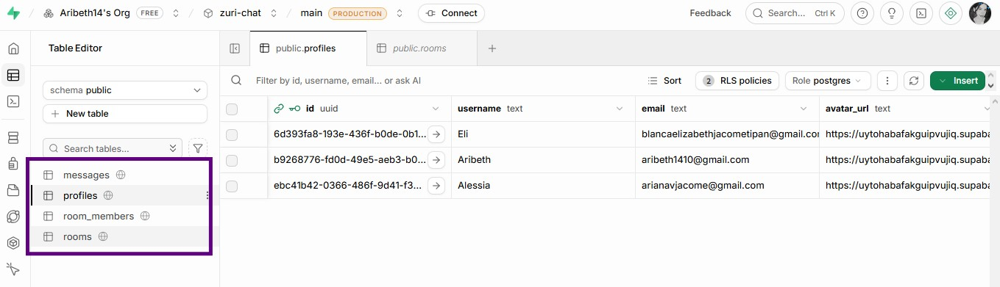
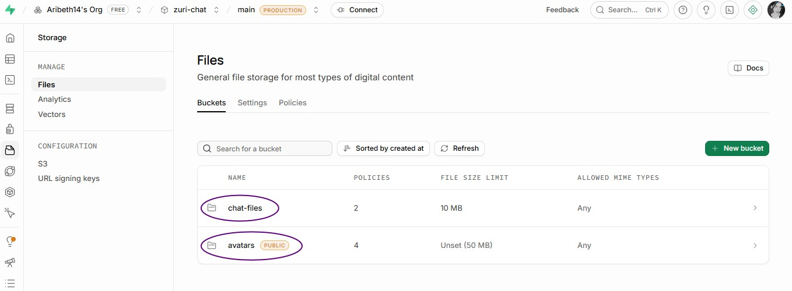
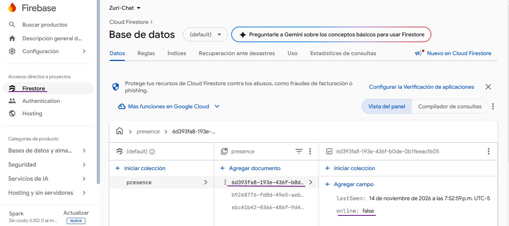
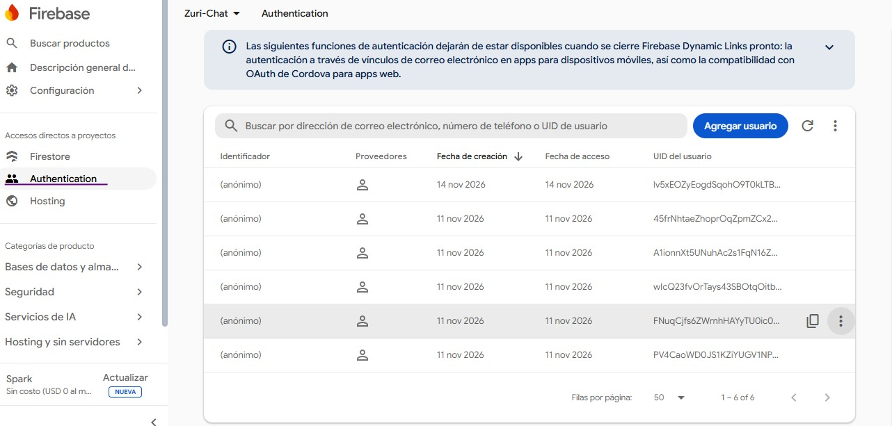

# Zuri

Aplicación de mensajería instantánea hecha con **Ionic, Angular y Capacitor**, que integra **Supabase** y **Firebase** a la vez. *Zuri* significa "hermoso" en suajili: la idea fue una mensajería con identidad visual propia.

> Proyecto académico individual.

## Enlaces

| Entregable | Enlace |
|---|---|
| APK (Android) | [Descargar desde Releases](https://github.com/TU_USUARIO/zuri-chat/releases) |
| Aplicación web | https://zuri-chat.netlify.app |
| Video demostrativo | https://TU-ENLACE-AL-VIDEO |

## Capturas

| Splash | Login | Registro |
|---|---|---|
|  |  |  |

| Conversaciones | Chat | Adjuntos |
|---|---|---|
|  |  |  |

| Imagen y ubicación | Nuevo grupo | Chat de grupo |
|---|---|---|
|  |  |  |

| Escribiendo / En línea | Perfil | En los teléfonos |
|---|---|---|
|  |  |  |

### Evidencias de Supabase

| Tablas de Supabase | Supabase Storage |
|---|---|
|  |  |

### Evidencias de Firebase

| Firebase Firestore | Firebase Authentication |
|---|---|
|  |  |

## Funcionalidades

| # | Funcionalidad | Servicio |
|---|---|---|
| 1 | Registro, inicio y cierre de sesión, sesión persistente | Supabase Auth |
| 2 | Edición de perfil y foto | Supabase Database + Storage |
| 3 | Lista de usuarios | Supabase Database |
| 4 | Mensajes de texto persistentes | Supabase Database |
| 5 | Chat en tiempo real | Supabase Realtime |
| 6 | Salas y chats grupales | Supabase Database |
| 7 | Envío de imágenes | Supabase Storage |
| 8 | Envío de archivos | Supabase Storage |
| 9 | Compartir ubicación | Supabase Database |
| 10 | Indicador de leído ("Visto") | Supabase Database + Realtime |
| 11 | Búsqueda de conversaciones | Cliente |
| 12 | Estado "en línea" y "escribiendo…" | **Firebase Firestore** |
| Extra | Eliminar mensajes propios | Supabase Database |

**Limitaciones:** la ubicación es estática (la posición del momento, no en vivo); la búsqueda filtra por nombre y último mensaje, no por todo el historial; los integrantes de un grupo se eligen al crearlo; no hay notificaciones push; y al eliminar un mensaje con archivo, el archivo permanece en Storage.

## Cómo se utilizan Supabase y Firebase

Cada servicio tiene una responsabilidad distinta. **Supabase guarda todo lo permanente; Firebase solo maneja estados que cambian cada pocos segundos.** Así no se duplica información: un mensaje existe solo en Supabase, y "está escribiendo" existe solo en Firebase.

| Servicio | Para qué se usa | Qué guarda |
|---|---|---|
| Supabase Auth | Registro, login y sesión | Usuarios y contraseñas cifradas |
| Supabase Database | Datos permanentes, protegidos con RLS | Perfiles, salas, integrantes y mensajes |
| Supabase Realtime | Chat en vivo | Mensajes nuevos, "Visto", mensajes eliminados |
| Supabase Storage | Archivos | Avatares (público) y archivos de chat (privado) |
| Firebase Auth (anónima) | Permitir el acceso a Firestore | Nada personal |
| Firebase Firestore | Estados efímeros | Colecciones `presence` y `typing` |

**Supabase** es el núcleo de la app. Autentica a los usuarios y guarda en cuatro tablas (`profiles`, `rooms`, `room_members`, `messages`) todo lo que debe permanecer. Un chat de dos personas es una sala con dos integrantes y un grupo es una sala con más, así que un mismo diseño sirve para los dos. La app se suscribe a esas tablas con Realtime, y por eso un mensaje aparece en el otro teléfono sin recargar. Las imágenes y archivos se guardan en Storage, y los de chat están en un bucket privado al que solo acceden los integrantes de la sala.

**Firebase** se encarga de dos indicadores. Mientras la app está visible, cada 25 segundos se escribe un "latido" en Firestore, y así los demás ven "En línea". Mientras alguien teclea, se crea un documento temporal que los demás ven como "escribiendo…". Si Firebase falla, el chat sigue funcionando y solo se pierden esos dos indicadores.

**Por qué el login es de Supabase y no de Firebase:** las políticas de seguridad de Supabase dependen de la identidad del usuario. Mezclar dos sistemas de identidad complicaba la seguridad sin aportar nada.

**Ejemplo de un mensaje:** al escribir se crea el estado "escribiendo" en Firebase; al enviar, el mensaje se guarda en Supabase y Realtime lo entrega al otro dispositivo; cuando el otro abre el chat, el mensaje pasa de "✓ Enviado" a "✓✓ Visto".

## Seguridad

- Políticas RLS en todas las tablas: cada persona solo ve las salas donde está.
- Las salas se crean con funciones del servidor que validan los datos, no desde la app.
- Los archivos de chat están en un bucket privado y se muestran con enlaces temporales de una hora.
- Los archivos con claves no se suben a GitHub, y la app solo usa claves públicas, sin credenciales administrativas.
- **Limitación de Firebase:** como el login real es de Supabase, las reglas de Firestore no pueden comprobar que cada persona escriba solo su propio estado. Se acepta porque ahí solo hay datos efímeros y poco sensibles; lo importante está protegido en Supabase.

## Instalación y ejecución

Requisitos: Node.js 20 o superior, Ionic CLI y cuentas gratuitas de Supabase y Firebase.

```bash
git clone https://github.com/TU_USUARIO/zuri-chat.git
cd zuri-chat
npm install
```

Las claves no están en el repositorio. Copia `src/environments/environment.example.ts` con los nombres `environment.ts`, `environment.development.ts` y `environment.prod.ts` (en este último, `production: true`) y pon tus claves de Supabase y Firebase.

```bash
ionic serve
```

## Configuración

**Supabase**

1. Crea un proyecto y copia la URL y la clave pública (`publishable` o `anon`) a tus archivos de entorno. Nunca uses la clave `secret` o `service_role`.
2. En *Authentication → Providers → Email*, desactiva *Confirm email*.
3. En *SQL Editor*, ejecuta [`supabase/schema.sql`](supabase/schema.sql): crea tablas, políticas, funciones y buckets, y activa Realtime.

**Firebase**

1. Crea un proyecto, registra una app web y copia su configuración a tus archivos de entorno.
2. En *Authentication*, habilita el acceso **anónimo**.
3. Crea Firestore en modo de producción y publica las reglas de [`firebase/firestore.rules`](firebase/firestore.rules).
4. Añade el dominio de la web en *Authentication → Configuración → Dominios autorizados*.

## APK

Requisitos: Android Studio con SDK y JDK 17 o superior.

```bash
ionic build
npx cap sync android
npx cap open android
```

En Android Studio: *Build → Build Bundle(s) / APK(s) → Build APK(s)*. Es un APK de depuración, suficiente para instalarlo directamente. Se publica en la sección **Releases** del repositorio.

## Despliegue web

La web está en **Netlify Drop**: https://zuri-chat.netlify.app

Se compila en local con `ionic build` y se arrastra la carpeta `www` a Netlify. Se añade un archivo `www/_redirects` con `/*  /index.html  200` para que las rutas funcionen al recargar. La carpeta `www` no se sube a GitHub porque contiene las claves compiladas.


## Autora

**Ariana Elizabeth Villota Jácome**

Tecnología Superior en Desarrollo de Software

Escuela de Formación de Tecnólogos (ESFOT)


